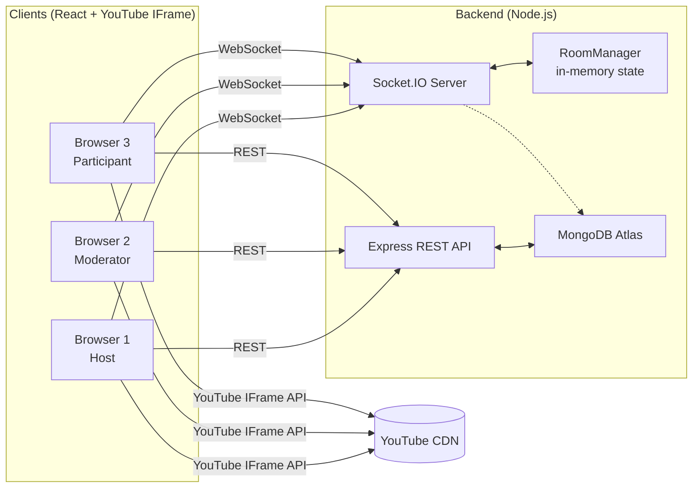
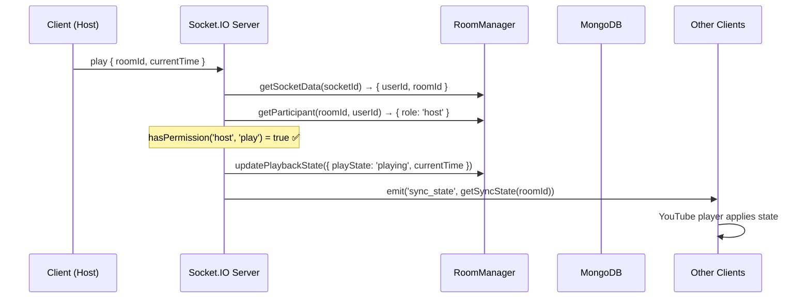
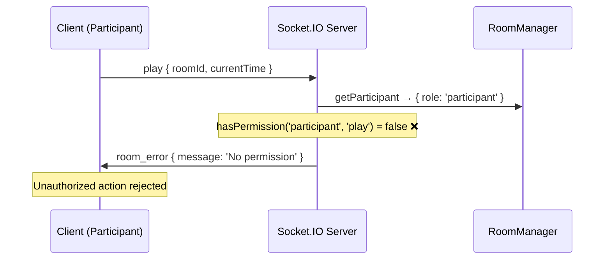
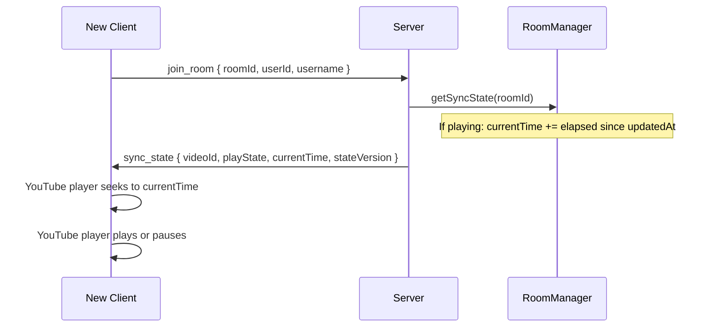
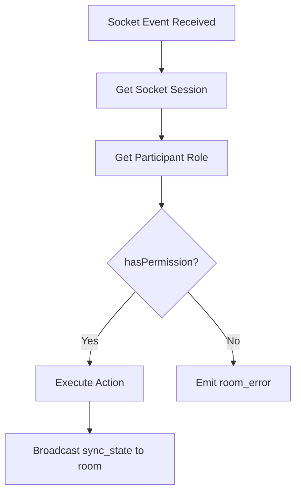

# SyncPlay – Architecture Documentation

## System Overview

SyncPlay is a MERN-stack real-time YouTube watch party platform. Each client embeds the official YouTube IFrame Player. The backend only synchronizes **playback commands** and **state metadata** — no video data flows through the server.



---

## Frontend Architecture

### Component Hierarchy

```
App.jsx
├── Sidebar.jsx (collapsible navigation)
├── pages/
│   ├── Home.jsx (cinematic landing page)
│   ├── Login.jsx / Register.jsx (auth forms)
│   ├── CreateRoom.jsx (room creation form)
│   ├── JoinRoom.jsx (room join form)
│   ├── WatchRoom.jsx ← CORE PAGE
│   │   ├── VideoPlayer.jsx (YouTube IFrame wrapper)
│   │   ├── PlaybackControls.jsx (host/mod controls)
│   │   ├── ParticipantList.jsx
│   │   │   └── ParticipantCard.jsx
│   │   ├── ChatBox.jsx (live chat + emoji)
│   │   ├── RequestPanel.jsx (approval system)
│   │   └── RoomInvite.jsx (share link)
│   └── NotFound.jsx
└── context/
    ├── AuthContext.jsx (user session, JWT, guest)
    └── SocketContext.jsx (Socket.IO singleton)
```

### State Management

- **AuthContext** – Stores user identity, JWT token, guest session
- **SocketContext** – Manages a single Socket.IO connection shared across components
- **WatchRoom local state** – Owns room-specific state: syncState, participants, messages, pendingRequests
- No Redux / Zustand needed at this scale

---

## Backend Architecture

### Request Flow (REST)

```
Client HTTP Request
  └── Express Router
        └── optionalAuth / protect middleware
              └── Controller function
                    ├── Validate input (express-validator)
                    ├── MongoDB query (Mongoose)
                    └── JSON response
```

### WebSocket Event Flow



### Unauthorized Event Flow



---

## Database Structure

### User Collection

```javascript
{
  _id: ObjectId,
  username: String,       // unique, 3-20 chars, alphanumeric+_
  email: String,          // unique, optional for guests
  password: String,       // bcrypt hashed, select:false
  avatar: String,
  isGuest: Boolean,
  createdAt: Date,
  updatedAt: Date
}
```

### Room Collection

```javascript
{
  _id: ObjectId,
  roomId: String,         // 6-char unique code (e.g. "AB3X7K")
  roomName: String,
  hostId: String,
  videoId: String,        // YouTube video ID
  playState: 'playing' | 'paused',
  currentTime: Number,    // seconds
  stateVersion: Number,   // monotonic counter, prevents stale events
  updatedAt: Date,
  participants: [{
    userId: String,
    username: String,
    role: 'host' | 'moderator' | 'participant',
    socketId: String,
    joinedAt: Date,
    isConnected: Boolean
  }],
  roomStatus: 'active' | 'closed',
  createdAt: Date
}
```

### Message Collection

```javascript
{
  _id: ObjectId,
  roomId: String,         // indexed
  senderId: String,
  senderName: String,
  senderRole: 'host' | 'moderator' | 'participant' | 'system',
  message: String,        // max 500 chars
  type: 'chat' | 'system' | 'reaction',
  emoji: String | null,
  timestamp: Date         // indexed
}
```

---

## Video Synchronization Flow

### Late-Join Synchronization



### Drift Correction

The `RoomManager.getAdjustedTime()` method:

```javascript
getAdjustedTime(roomId) {
  const room = this.rooms.get(roomId)
  if (room.playState === 'playing') {
    const elapsed = (Date.now() - room.updatedAt) / 1000
    return room.currentTime + elapsed   // ← compensates for real elapsed time
  }
  return room.currentTime
}
```

### stateVersion Anti-Loop

Every `sync_state` includes a `stateVersion` counter. The YouTube player component:
- Rejects sync events with `stateVersion <= lastVersionRef.current`
- Prevents infinite loops when player state changes trigger re-syncs

---

## Role-Based Access Control



Role inheritance (most → least powerful):

```
Host > Moderator > Participant
```

Host is always assigned at room creation. Roles are stored in both MongoDB and in-memory `RoomManager`. All permission checks run **server-side**; client-supplied roles in event payloads are ignored.

---

## Scalability Considerations

### Current Architecture (Single Server)

Suitable for:
- ~100 concurrent rooms
- ~50 users per room
- ~1,000 concurrent WebSocket connections

### Scaling to 1,000+ Rooms

1. **Socket.IO Redis Adapter**
   ```bash
   npm install @socket.io/redis-adapter ioredis
   ```
   ```javascript
   const { createAdapter } = require('@socket.io/redis-adapter')
   io.adapter(createAdapter(pubClient, subClient))
   ```
   This allows multiple Node.js processes to share room state via Redis Pub/Sub.

2. **Horizontal Scaling**
   - Run multiple backend instances behind Nginx (with sticky sessions or Redis sessions)
   - Use PM2 cluster mode

3. **Room State in Redis**
   - Replace in-memory `RoomManager` Map with Redis hashes
   - `HSET syncplay:room:{roomId} videoId playState currentTime ...`

4. **MongoDB Optimization**
   - Add TTL index on rooms for auto-cleanup
   - Shard by `roomId`
   - Use MongoDB Atlas auto-scaling

> These targets are architectural goals. Actual load testing is required to verify capacity.

